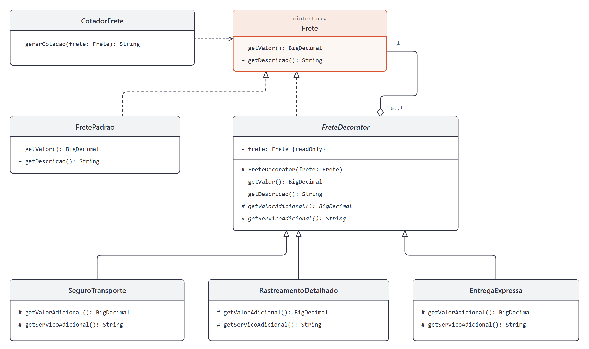

# DCC078 - Padrões de Projeto: Decorator

**Aluno:** Felipe Lazzarini Cunha

## Tema

O projeto representa a cotação de frete com serviços opcionais de seguro de transporte, rastreamento detalhado e entrega expressa. O Decorator permite combinar esses serviços, acrescentando seus valores e descrições ao frete padrão. A cotação é simulada com valores fixos, sem integração com transportadoras.

## Diagrama de Classes UML



## Estrutura do Projeto

- `Frete`: interface comum ao frete básico e aos serviços adicionais.
- `FretePadrao`: componente concreto que fornece o valor e a descrição do frete básico.
- `FreteDecorator`: classe abstrata que envolve um frete e acrescenta um serviço.
- `SeguroTransporte`, `RastreamentoDetalhado` e `EntregaExpressa`: decoradores concretos que podem ser combinados.
- `CotadorFrete`: cliente que gera uma cotação usando a interface `Frete`.

## Testes

Com JDK 11 ou superior e Maven:

```bash
mvn test
```
